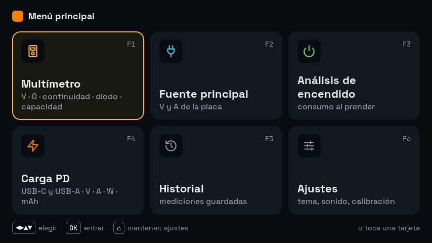
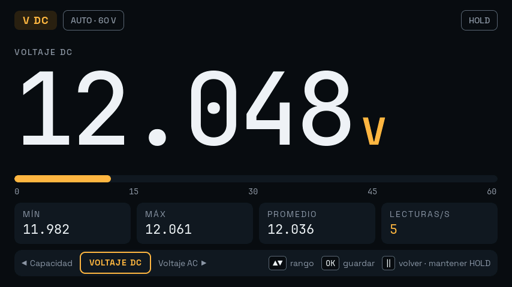
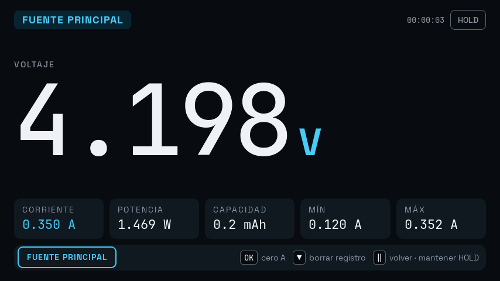
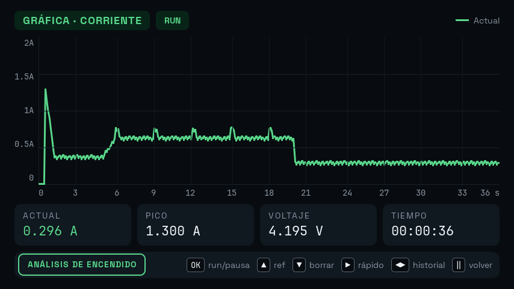
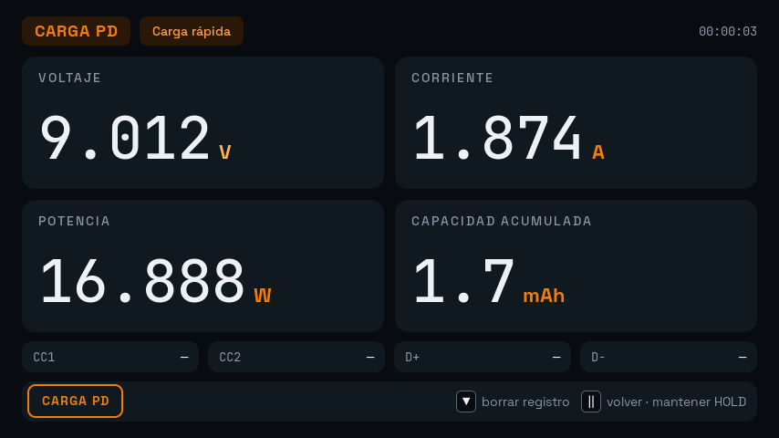
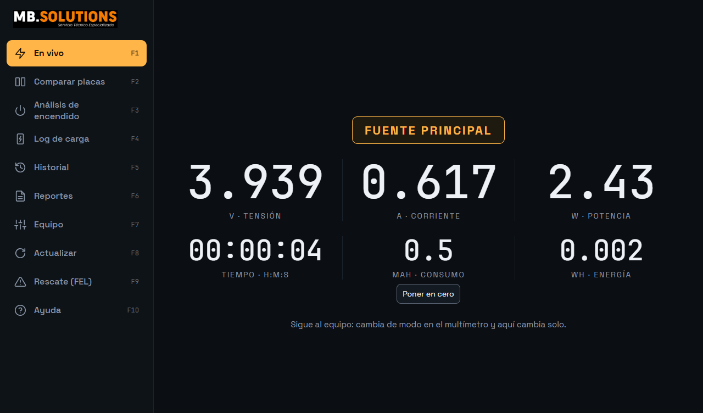
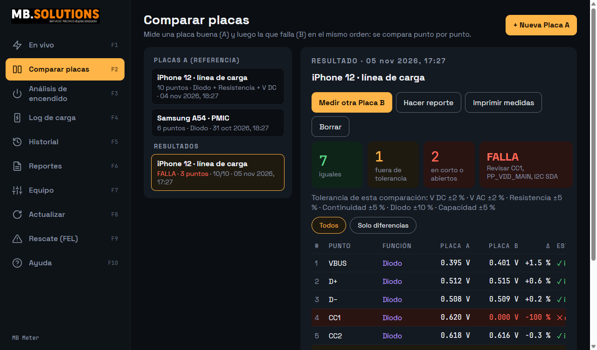
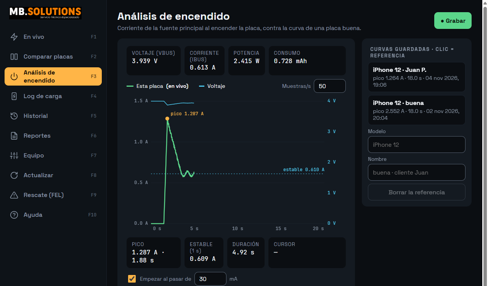
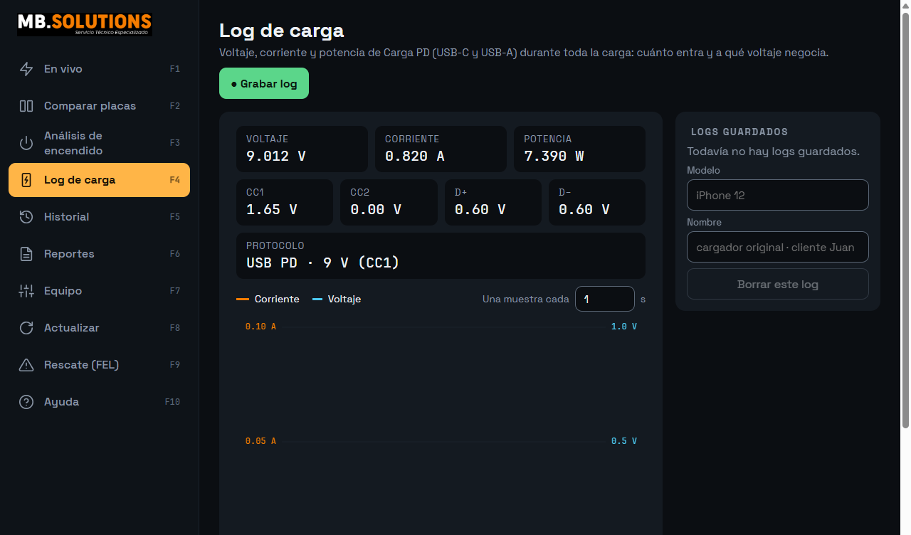

# YS-4470 · Firmware MB + MB Meter

Firmware alternativo para el multímetro y fuente **YS-4470**, y **MB Meter**, su programa para Windows.
Pensado para el banco de reparación de teléfonos: medir, ver el consumo al encender y comparar una placa buena contra una mala.

**Versión actual:** firmware MB 0.9.9 · MB Meter 0.2.0

## Descargar

1. Entra a **[Releases](https://github.com/MBSOLUTIONS-MB/ys4470-descargas/releases/latest)** (no hace falta cuenta).
2. Descarga `MB-Meter_x.y.z_x64-setup.exe` y ejecútalo (Windows 10/11).
3. Conecta el equipo por USB y abre MB Meter. Funciona sin driver.

Las siguientes versiones llegan solas: MB Meter avisa cuando hay una nueva, del programa o del firmware.

## El firmware en el equipo

**Inicio con seis funciones, sin menús perdidos.** F1 a F6 directo con tecla o tocando la tarjeta.

| | |
|---|---|
|  | **Multímetro (F1).** V DC, V AC, Ω, continuidad, diodo y capacidad. Número grande, barra de escala y debajo mínimo, máximo y promedio: ves si la lectura es estable sin anotar nada. |
|  | **Fuente principal (F2).** Voltaje y corriente que toma la placa. Si la corriente se sale de rango marca **«OL»** en vez de un número falso: señal de corto. Alarma de voltaje configurable, ahora también en 2.00 V. |
|  | **Análisis de encendido (F3).** La curva de consumo al prender: pico, voltaje y tiempo en vivo. Una placa en corto, que no arranca o que se reinicia se reconoce por su curva. |
|  | **Carga PD (F4).** USB-C o USB-A: V, A, W y mAh acumulados. |

También: **Historial (F5)** con las mediciones guardadas y **Ajustes (F6)** con tema de color, sonido, brillo y calibración.

## MB Meter en la PC

**En vivo.** El equipo en grande en tu PC. Cambias de función en el equipo y el programa cambia solo. Suma tiempo, mAh y Wh, y tiene ventana flotante para dejarla encima de otros programas.

**Comparar placas.** Mides una placa buena y luego la que falla, en el mismo orden. El programa marca qué puntos son iguales, cuáles se salen de tolerancia y cuáles están en corto o abiertos. Guarda solo cuando la lectura se estabiliza, y la tolerancia se ajusta por función, de 0.5 % a 50 %.

**Análisis de encendido.** Compara la curva de una placa contra la de una placa buena del mismo modelo, guardada antes.

**Log de carga.** Toda la carga registrada, con las líneas CC1, CC2, D+ y D− y el protocolo negociado (por ejemplo USB PD 9 V). Se guarda como CSV o imagen.

Además: **Historial**, **Reportes** para el cliente, **Actualizar** y **Rescate (FEL)**.

## Actualizar y rescatar sin miedo

- **Por USB, desde MB Meter.** El archivo se envía y se comprueba completo antes de tocar nada. El equipo no se graba hasta que pulses **OK** en él. Cada bloque se graba, se relee y se reintenta si falla.
- **Copia de seguridad.** La primera vez que grabas, MB Meter guarda la memoria entera del equipo (16 MB) en Documentos. Con esa copia siempre puedes volver al firmware de fábrica.
- **Rescate (FEL).** Si el equipo no arranca, MB Meter lo graba en modo FEL. El instalador trae la herramienta y, si quieres, el driver.

El logo de arranque de fábrica no se cambia; si quieres uno propio, se pone desde MB Meter.

## Novedades de esta versión

- Actualización por USB confiable: reintenta cada bloque y lo comprueba; si algo falla queda anotado en `%APPDATA%\com.mbsolutions.mbmeter\actualizacion.log`.
- Ya no se queda pitando al instalar.
- Un solo instalador con programa, herramienta de grabado, driver opcional y firmware.

## Aviso

**No uses salidas de 19–23 V con teléfonos.** Revisa el voltaje antes de conectar una placa.

---
MB.SOLUTIONS · Servicio Técnico Especializado
